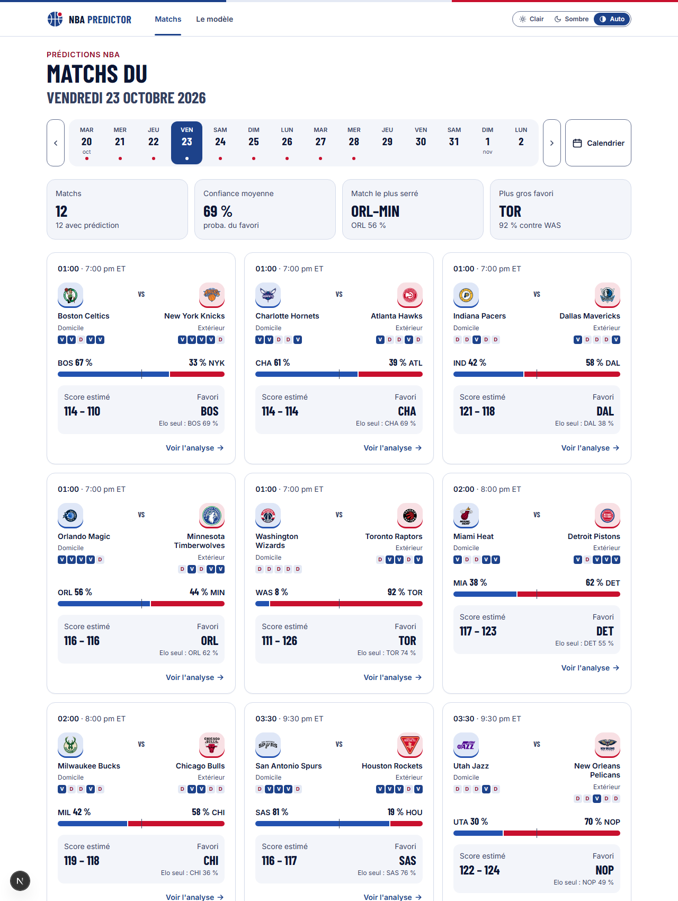
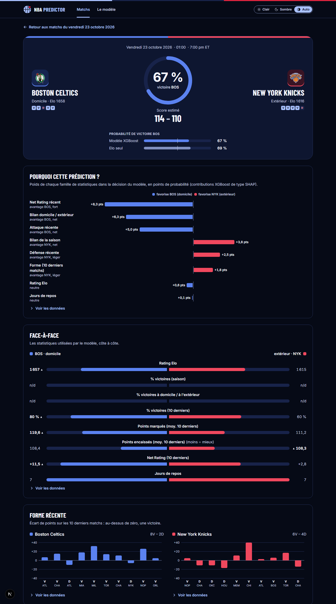
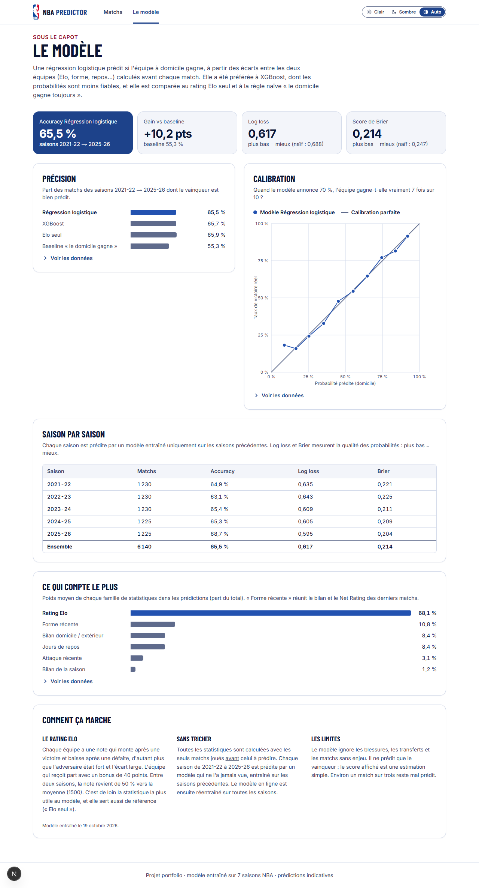

# NBA Predictor

Application web qui prédit l'issue des matchs NBA : probabilité de victoire, score estimé, et surtout **l'explication** de chaque prédiction (quelles statistiques ont pesé, et dans quel sens).

Projet personnel réalisé en BUT MMI (parcours Dev) pour travailler un projet complet de bout en bout : collecte de données, machine learning, API REST et interface web.

**En ligne : [nba.remicoimbra.fr](https://nba.remicoimbra.fr)**



## Ce que fait l'application

- **Matchs du jour** : un bandeau de 14 jours et un calendrier mensuel au clavier, avec pour chaque match la probabilité de victoire, le score estimé et la forme récente des deux équipes.
- **Fiche match** : pourquoi le modèle prédit ce résultat (contributions exactes de chaque statistique, regroupées par famille), comparaison côte à côte des deux équipes, courbes de forme et d'évolution de l'Elo.
- **Page « Le modèle »** : précision, log loss, score de Brier, résultats saison par saison, courbe de calibration et poids de chaque famille de statistiques, lus directement dans les résultats du dernier entraînement.
- **Accessibilité** : couleurs vérifiées au contraste WCAG AAA (`npm run check:contrast`), thème clair et sombre, navigation au clavier, tableau de données alternatif pour chaque graphique, animations réduites si le système le demande.

| Fiche match (sombre) | Page « Le modèle » |
| --- | --- |
|  |  |

## Résultats du modèle

Validation **walk-forward** : chaque saison de 2021-22 à 2025-26 est prédite par un modèle entraîné uniquement sur les saisons précédentes, qu'il n'a donc jamais vue (6 140 matchs au total). Aucune information du futur n'entre dans une feature, ce que vérifie un contrôle automatique.

| Modèle | Précision | Log loss | Brier |
| --- | --- | --- | --- |
| Règle naïve « le domicile gagne » | 55,3 % | 0,688 | 0,247 |
| **Régression logistique (utilisée par l'API)** | 65,5 % | 0,617 | 0,214 |
| XGBoost | 65,7 % | 0,621 | 0,216 |
| Elo seul (sans apprentissage) | 65,9 % | 0,618 | 0,215 |

La précision varie de 63 % à 69 % selon la saison. Sur la seule saison 2025-26, la plus facile de la période, les trois modèles atteignent 69 %. La régression logistique, qui ne garde que 11 variables (écarts entre les deux équipes et Elo de chacune), donne les meilleures probabilités : sa log loss est significativement plus basse que celle de XGBoost, dans le même sens sur les 5 saisons. C'est donc elle qui est en ligne, et chacune de ses prédictions se décompose exactement en contributions des statistiques. Les paramètres de l'Elo (avantage du terrain, régression entre saisons) ont été réglés sur des saisons passées puis confirmés sur deux saisons jamais vues ; l'Elo seul fait alors jeu égal avec la régression logistique, ce qui veut dire que les autres statistiques n'apportent presque rien de plus. La variable de loin la plus utile est la **différence de rating Elo** entre les deux équipes ; c'est elle qui a fait passer la précision de 66,8 % à près de 69 % (sur 2025-26) pendant le développement.

**Limites assumées** : le modèle ignore les blessures, les transferts et les joueurs absents. Le score affiché est une heuristique (forme offensive et défensive récente), pas un modèle de régression : le modèle ne sait que classer victoire ou défaite. En tout début de saison, `win_pct` n'a pas encore de valeur, et les premières prédictions reposent surtout sur l'Elo et la forme de fin de saison précédente.

## Architecture

```
nba_api ──> data/ (collecte, nettoyage, features, entraînement)
                 │  fichiers JSON/CSV + modèle .pkl
                 ▼
            api/ (FastAPI : prédiction à la demande)
                 │  JSON
                 ▼
            front/ (Next.js + Tailwind : tableau de bord)
```

| Dossier | Rôle | Stack |
| --- | --- | --- |
| [data/](data/) | Collecte, nettoyage, feature engineering, entraînement | Python, pandas, scikit-learn, XGBoost, `nba_api` |
| [api/](api/) | Sert les prédictions et les métriques | FastAPI, uvicorn |
| [front/](front/) | Interface web, graphiques SVG maison | Next.js (App Router), Tailwind CSS v4, `motion` |
| [infra/](infra/) | Synchronisation quotidienne des données vers le serveur | PowerShell, SSH |

Le détail (choix techniques, flux de données, pièges rencontrés) est dans [docs/architecture.md](docs/architecture.md).

## Lancer le projet en local

Prérequis : Python 3.12 ou plus récent, Node.js 20 ou plus récent.

Les données et le modèle ne sont pas versionnés : il faut d'abord générer les fichiers (quelques minutes, le téléchargement dépend de `stats.nba.com`).

```powershell
# 1. Données + modèle
cd data
python -m venv ..\api\venv ; ..\api\venv\Scripts\Activate.ps1
pip install -r requirements.txt
python collectors\fetch_games.py
python preprocessing\clean_data.py
python preprocessing\feature_engineering.py
python models\train_model.py
python preprocessing\team_state.py
python collectors\fetch_schedule.py

# 2. API (http://127.0.0.1:8000/docs)
cd ..\api
pip install -r requirements.txt
uvicorn app.main:app --reload

# 3. Front (http://localhost:3000), dans un autre terminal
cd front
npm install
npm run dev
```

Si le port 8000 est pris, lancer l'API avec `--port 8001` et le front avec `$env:NEXT_PUBLIC_API_URL = "http://127.0.0.1:8001"`. Le front doit rester sur `localhost:3000` (origine autorisée par CORS).

Pour mettre à jour les matchs et le calendrier au quotidien, sans réentraîner : `.\infra\sync_to_vps.ps1 -NoPush`.

Contrôles du front : `npm run lint`, `npm run build`, `npm run check:contrast`.

## Endpoints de l'API

| Route | Description |
| --- | --- |
| `GET /games/today?date=AAAA-MM-JJ` | Matchs d'un jour (aujourd'hui par défaut) avec prédiction |
| `GET /games/calendar` | Jours disponibles et nombre de matchs |
| `GET /games/{game_id}` | Fiche complète d'un match : facteurs, statistiques, historique d'Elo |
| `GET /model/metrics` | Résultats du dernier entraînement |

En production, ces routes sont servies sous `/api` (par exemple `https://nba.remicoimbra.fr/api/games/calendar`).

## État d'avancement

Fait : collecte, features, modèle, API, interface complète (3 pages), synchronisation quotidienne du calendrier et des données, déploiement sur un VPS (voir [docs/deploiement.md](docs/deploiement.md)).

À faire : base de données (les fichiers JSON et CSV en tiennent lieu pour l'instant), endpoints `teams` et `predictions`.

## Données

Les données viennent de [`nba_api`](https://github.com/swar/nba_api), qui interroge `stats.nba.com`. Les logos des équipes appartiennent à la NBA et à leurs franchises ; ils servent ici uniquement à l'illustration. Projet non affilié à la NBA.
